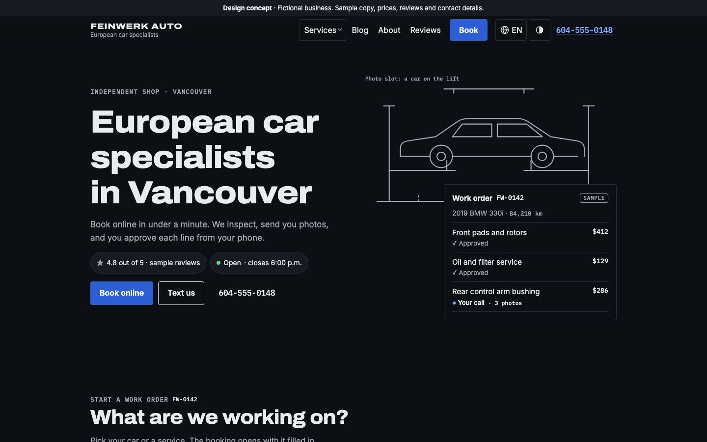
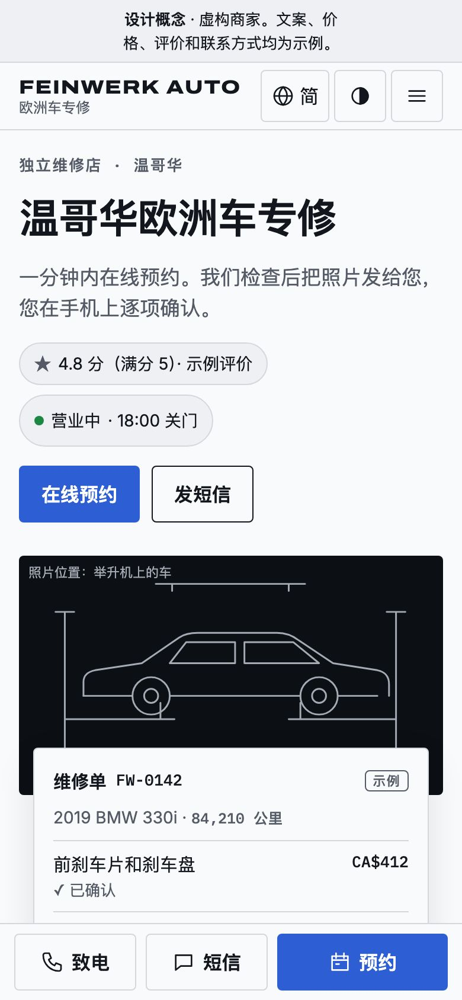
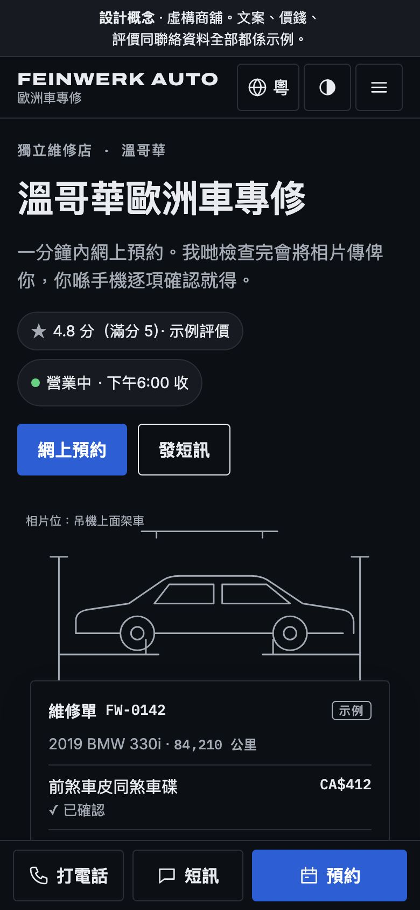
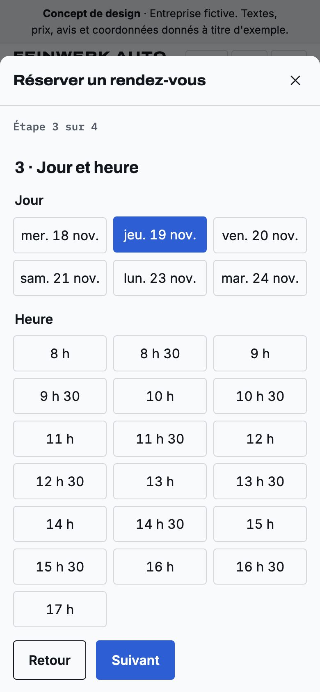

# Feinwerk Auto (design concept)

**Not a real business.** Feinwerk Auto is a fictional European car repair shop in Vancouver, built as a design concept and portfolio piece. The phone number (604-555-0148, a range reserved for fiction), the address, reviews, ratings and prices are samples. Make names only describe the cars serviced; nothing here is affiliated with any company or vehicle manufacturer.
Every page says so in a "Design concept" strip at the top and a disclaimer in the footer, and carries `noindex, nofollow`.

Live: <https://mingz6.github.io/feinwerk-auto/> · Plan: [PLAN.md](PLAN.md) · Decisions: [docs/decisions.md](docs/decisions.md) · Case study: [docs/case-study.md](docs/case-study.md)



  

Desktop in dark (English); phones in 简体中文 (light), 廣東話 (dark) and the French booking sheet at step 3. `node scripts/readme-shots.mjs` retakes them on the same fixed Wednesday 10:00 Vancouver clock as the test baselines.
The review set, the first phone screen of Home, the BMW and MINI page and Book in every language and theme (24 shots), is in [docs/screenshots/phone/](docs/screenshots/phone/) (`--phones`).

## What it is

A shop site built around three things a phone visitor needs: book in under a minute, honest proof (the inspection photo, warranty terms, reviews, all labelled Sample) and a page per make that answers real questions about its engines. 19 pages in 4 languages (76 in all, 73 built: the 404 is one page for every language), a 4-step booking flow that sends nothing, three blog posts per language.

Astro 7 with static output, TypeScript strict, no client framework. The largest page ships 5.4 KB of JavaScript gzipped (the bar is 15 KB). Hosted on GitHub Pages.

## Lighthouse (mobile)

Measured on the live site, 19 Nov 2026, Lighthouse 13.6.0, Slow 4G and 4× CPU slowdown (simulated), 3 runs per page, median shown.

| Page | Performance | Accessibility | Best Practices | LCP | CLS | Total blocking time | Transfer |
|---|---|---|---|---|---|---|---|
| [Home](https://mingz6.github.io/feinwerk-auto/) | 100 | 100 | 100 | 0.9 s | 0 | 0 ms | 172 KB |
| [Book](https://mingz6.github.io/feinwerk-auto/book/) | 100 | 100 | 100 | 0.8 s | 0 | 0 ms | 168 KB |

The bars (PLAN.md, Quality bar): the three scores at 100, LCP (Largest Contentful Paint) ≤ 1.8 s, CLS (Cumulative Layout Shift) ≤ 0.05, blocking time ≤ 100 ms, the home page ≤ 500 KB. SEO scores 63 on purpose: `noindex` keeps a fictional shop out of search results.
CI runs the same check on every push against a local preview (`lighthouserc.json`): layout shift, weight, accessibility and best practices must pass on every run, performance, LCP and blocking time on the median of 3.

## Languages

| Language | URL | `lang` / `hreflang` | Dictionary |
|---|---|---|---|
| English (Canada) | `/` | `en-CA` / `en` | `src/i18n/en.ts` |
| Français (Canada) | `/fr/` | `fr-CA` / `fr` | `src/i18n/fr.ts` |
| 简体中文 | `/zh-hans/` | `zh-Hans` | `src/i18n/zh-hans.ts` |
| 廣東話 (written Cantonese, Traditional characters) | `/zh-hk/` | `zh-HK` | `src/i18n/zh-hk.ts` |

- **First visit**: the English pages read `navigator.languages` and send the visitor to the first match: `fr*` to French; `zh-Hans`, `zh-CN`, `zh-SG` or plain `zh` to 简体中文; `zh-Hant`, `zh-HK`, `zh-MO`, `zh-TW` or `yue` to 廣東話; anything else stays English. A script subtag beats a region (`zh-Hans-HK` reads Simplified). The code is `src/lib/lang.ts`, with unit tests.
- **A choice in the language menu wins.** It is stored as `feinwerk-lang` in `localStorage` and beats the browser's list from then on.
- **A language URL never redirects.** Only the English pages check; `/fr/` stays French for everyone, so a shared link opens in the language it was shared in.
- **Without JavaScript** the English page simply stays; the language menu is a `<details>` list of links, so it still opens.
- **Four dictionaries, no converter.** Cantonese and Mandarin differ in words and grammar, not just characters. 
  Tests fail the build when a key is missing in any language, `{placeholders}` differ, a page or post lacks one of its four versions, a hard-coded English string shows up in a component, or a Chinese source mixes scripts.
- **Fonts**: Archivo, Inter and IBM Plex Mono are self-hosted (`latin` and `latin-ext`, French needs œ); Chinese uses the system fonts (PingFang, Noto Sans CJK, Microsoft YaHei or JhengHei), set per `:lang()`.
- Blog posts live in `src/content/blog/{en,fr,zh-hans,zh-hk}/`, written per language rather than translated word for word.

## Themes

One button cycles Auto (follows the system), Light and Dark. The choice is stored as `feinwerk-theme`; Auto stores nothing.

- **No flash.** An inline script in `<head>` (`src/layouts/Base.astro`) sets `data-theme` and the `theme-color` meta before first paint. A Playwright test records the attribute the moment `<body>` exists.
- **Tokens are written out twice** in `src/styles/`: once under `prefers-color-scheme: dark`, once for the manual `data-theme` choice. No `light-dark()`: iOS Safari before 17.5 ignores it. Every text pair is at least 4.5:1 in both themes (the table is in PLAN.md).
- **Print is always light**, with hours, address and phone kept and the bars and menus gone. Drawings use `currentColor`, so they follow the theme.
- Without JavaScript the theme button is hidden and the page follows the system.

## Private override

Real contact details, for showing the demo to someone in person, go in `src/data/site.private.json`. It is gitignored and merged over `src/data/site.json` at build time (`src/lib/site.ts`), so CI, which never has it, always publishes the placeholders.

```json
{
  "name": "Shop name",
  "phone": "+1 604-000-0000",
  "phoneDisplay": "604-000-0000",
  "address": { "street": "1 Real St", "postal": "V5V 0A0" },
  "mapsUrl": "https://maps.example/…"
}
```

`address` merges field by field. `mapsUrl` adds the directions link, which the public build leaves out: a maps link for a made-up address would send someone to a real place. Build with the file present, show from `npm run preview`, then delete it or leave it; it never reaches git.

The booking provider is one line in `src/data/booking.ts`: `demo` ships (nothing leaves the browser), `tekmetric` hands off to a shop's Tekmetric booking page, `form` posts to a form service.

## Run it

Node 26.

```sh
npm ci
npm run build      # astro check && astro build
npm test           # unit tests, and the demo-safety checks over dist/
npm run preview    # http://localhost:4321/feinwerk-auto/
npm run test:e2e   # Playwright end to end
npm run test:visual  # 48 screenshot baselines (rendered by CI on ubuntu)
npm run test:axe   # axe on every page, both themes, phone and desktop
npm run validate:html && npm run check:links
npm run lhci       # Lighthouse CI, mobile
```

Locally, start `npx astro preview --port 4391` first and run Playwright with `PW_PORT=4391`: Astro 7 backgrounds the preview, so Playwright's own web server exits early. A visual change fails the screenshot step in CI; look at the diff in the run's `reports` artifact, then `npm run test:visual:update -- <run-id>` copies CI's renders in as the new baselines.

## Gates

Every push runs `.github/workflows/ci.yml` on ubuntu: type check, 778 unit, build-output and docs tests, HTML validation, a link check (4,865 internal links on 73 pages), 88 end-to-end tests, 48 screenshot diffs, 120 axe runs (the same 48, plus every other page type in both themes on phone and desktop) and Lighthouse CI. Pushes to `main` and `phase-*` deploy to Pages only when all of it passes.

Two checks are manual: the real-device pass (an iPhone on iOS 16 or 17 and a current Android, VoiceOver on the 廣東話 page) and a native speaker's read of the French and Cantonese text. Neither is done yet.

## Photos

No stock, downloaded or AI-generated images. Every image slot is an SVG line drawing until a photo taken for the demo replaces it, with maker badges and plates blurred; the slots (shot, crop, size) are listed in [src/assets/photos/README.md](src/assets/photos/README.md).
