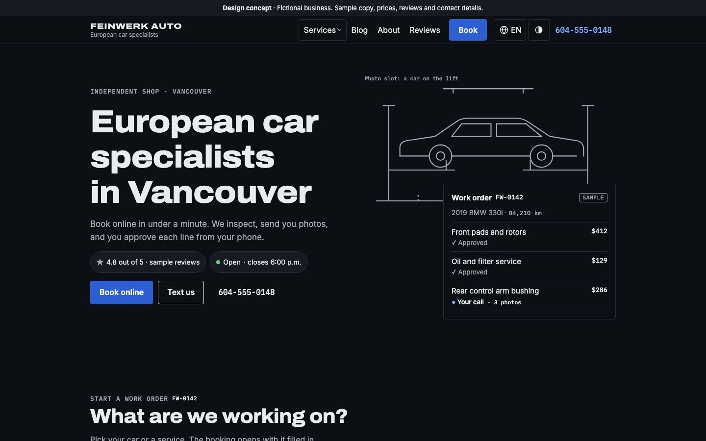
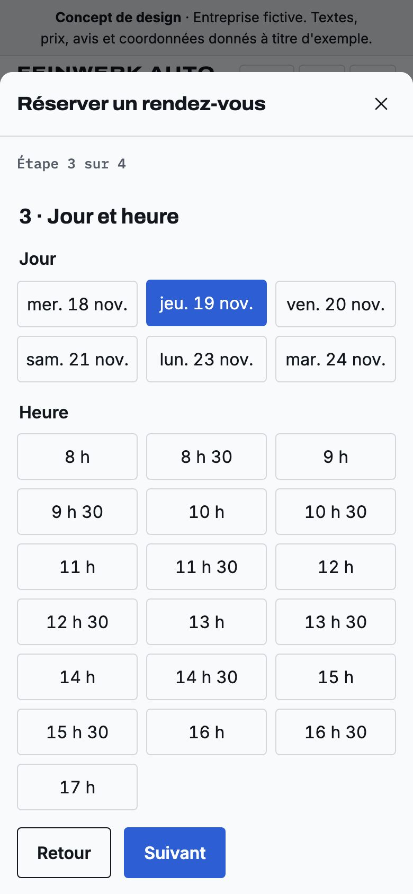
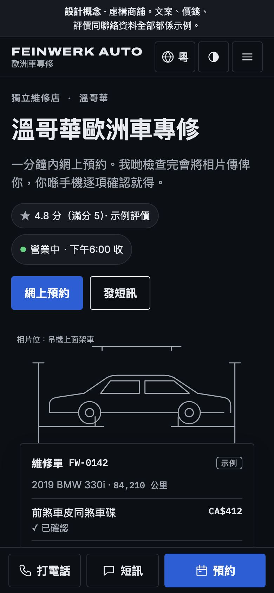

In November 2026 I looked at six European car specialists around Vancouver. One had real online booking and Call and Book buttons that stay on screen on a phone. The rest relied on the phone, a mailto link or a request form. So I built the site I'd want as a customer: book in under a minute on a phone, honest proof of the work, and a page per make that answers real questions about its engines. Feinwerk Auto is fictional: the name, the 555 phone number, the address, the reviews and the prices are all made up and labelled as samples on the page.

## What it does

19 pages in English, French, Simplified Chinese and written Cantonese, with Auto, Light and Dark themes. The home page opens on a sample work order: each line has a price and an "Approved" or "Your call" tag, which is how the shop sells itself (we inspect, send photos, you approve each line from your phone). Tap a make, read what fails on its engines (N20 and M274 timing chains, DSG mechatronic units), and every block has a Book button that opens the booking sheet with the make and service filled in.

Booking is a `<dialog>` sheet in four steps: car, service, day and time, contact details. It opens at the first step that isn't filled in, so from an engine block you land on day and time. Slots come from the shop's hours in Vancouver time. The confirmation gives you a calendar file and says plainly: "This is a demo. Nothing was sent."

 

## The interesting parts

**Cantonese is its own language.** The usual shortcut is to write Traditional Chinese and convert it to Simplified. That works when both are standard written Chinese, but Cantonese uses different words and grammar (我哋, 嘅, 唔使), so the site has four dictionaries and no converter. Tests fail the build if a key is missing anywhere, if placeholders differ, or if a Chinese file mixes scripts: the Cantonese file can't contain Simplified-only characters, and the Mandarin one can't contain 嘅 or 哋. Shop words follow Hong Kong usage (車呔 for tire, 火嘴 for spark plug) and the clock does too ("下午3:30"), while French gets Canadian times ("8 h 30") and no-break spaces before colons.

**Booking without JavaScript sends nothing.** Without a script, Book goes to a `/book/` page with the whole form. A normal form submit would have put a name, phone and email in a URL on someone's server, which would make "Nothing was sent" a lie. The form uses `method="dialog"`, so the browser still checks every field and then just closes it, and CSS shows the confirmation. Behind the flow is a small `BookingProvider` interface with three versions: `demo` (ships), `tekmetric` (hands off to a shop's Tekmetric booking page) and `form` (posts to a form service). A real shop changes one line of config.

**Themes without a flash, on old iPhones too.** An inline script in `<head>` sets the stored theme before first paint, and a Playwright test checks the attribute is there the moment `<body>` exists. The colours are written out twice, once for the system setting and once for the manual choice, instead of `light-dark()`, which iOS Safari before 17.5 ignores.

## What the gates caught

Every push runs the same checks: type check, 778 unit, build-output and docs tests, HTML validation, a link check over 4,865 links, 104 end-to-end tests, 48 screenshot diffs (3 pages × 4 languages × 2 themes × phone and desktop), 120 accessibility scans and Lighthouse. A few things they found that I wouldn't have seen by clicking around:

- **A layout shift that passed 2 runs out of 3.** Lighthouse measured CLS (Cumulative Layout Shift) 0.508 on the booking page in one run: the script hid steps 2 to 4 after the first paint whenever the paint won the race. CSS now hides them up front. Lighthouse CI had passed it because its default takes the best of 3 runs, so layout shift and page weight now have to pass on every run.
- **A page 658 px wide on a 390 px phone.** A visually hidden "5 out of 5" escaped the review row and widened every home page in all four languages. Chrome didn't scroll, but iOS Safari can pan a page that wide. A test now checks the width of every home page.
- **A phone pattern browsers ignored.** The `pattern` attribute compiles with the regex `v` flag, where the character class was invalid, so browsers silently dropped it. The patterns now live in one file shared by the browser and the validator.
- **Two clocks that disagree.** Node 26 and Chromium 159 ship time-zone databases that disagree about BC after November 2026. The slot tests check only what both agree on, and slots stay wall-clock times until the calendar file turns one into an instant.
- **Screenshots that differ by 1%.** The same Playwright image in Docker on a Mac rendered font edges about 1% differently from GitHub's runner on 44 of 48 shots. The baselines are CI's own renders, copied from a run's artifact after the diff is reviewed.

## Results

| Page (live, mobile, Slow 4G, 4× CPU) | Performance | Accessibility | Best Practices | LCP | Blocking time | Transfer |
|---|---|---|---|---|---|---|
| Home | 100 | 100 | 100 | 0.9 s | 0 ms | 172 KB |
| Book | 100 | 100 | 100 | 0.8 s | 0 ms | 168 KB |

LCP is Largest Contentful Paint, median of 3 runs on 19 Nov 2026. The largest page ships 5.4 KB of JavaScript, gzipped. axe reports zero violations on all 48 combinations and on every other page type, in both themes. SEO scores 63 on purpose: every page is `noindex`, so a fictional shop never shows up in search.

Still to do before I show it to anyone: a pass on a real iPhone (iOS 16 or 17) and Android, VoiceOver on the Cantonese page, a native speaker's read of the French and Cantonese, and my own photos in place of the line drawings.

## Tech Stack

- Astro 7 (static output), TypeScript strict, no client framework
- Plain CSS: OKLCH tokens in a `@layer`, container queries, `:has()`, `<dialog>`
- Self-hosted Archivo, Inter and IBM Plex Mono; system fonts for Chinese
- `node --test`, Playwright, axe, Lighthouse CI, html-validate
- GitHub Actions and GitHub Pages

## How It Works

- `src/i18n/{en,fr,zh-hans,zh-hk}.ts`: one dictionary per language, English at `/`, the others under `/fr/`, `/zh-hans/` and `/zh-hk/`. The first visit picks a language from the browser; a choice in the menu is stored and wins; a language URL never redirects.
- `src/lib/`: language detection, opening hours, booking slots, the calendar file and the booking providers, each with unit tests.
- `src/data/site.json` holds the sample name, phone, address and hours. Real details for an in-person showing go in a gitignored `site.private.json` that's merged at build, so the public build always has the placeholders.
- One `Service.astro` view renders all seven service pages from a data file; one dynamic route per language lists them.
- Decisions, with a line of why each, are in [docs/decisions.md](decisions.md).
